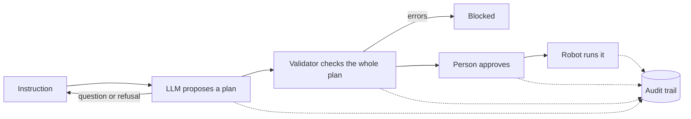
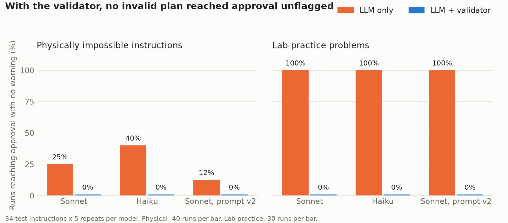

# Natural-language control of a lab liquid handler, with safety checks

A proof of concept that lets a scientist type an instruction like *"Put 50 µL from source A1 into target B1, B2 and B3"* and have a liquid handling robot carry it out, with the plan checked against the deck and approved by a person before anything moves.

Everything runs on a simulated Hamilton STARlet, so no robot is needed.

## The problem

Lab robots are fast and precise, but programming them takes specialist software and training. An LLM can turn plain language into robot commands, but LLMs make mistakes with confidence. In a pharma lab, a wrong volume or an overfilled well isn't just a bug: it can ruin an assay plate and cost days of work.

So the question this project looks at is not only *"can an LLM control a liquid handler?"* but *"how reliable is it, and what has to sit around it so that mistakes don't reach the robot?"*

## How it works



1. **The LLM proposes a plan.** It can only use four tools: `transfer`, `distribute`, `ask_clarification` and `refuse`. It never writes code and never talks to the robot directly. If information is missing, it asks.
2. **The validator checks the whole plan before the first movement.** It replays each step on a copy of the deck, so it catches problems that only show up in combination, like a source well running dry halfway through. It checks two kinds of rules:
   - **Physical limits (block the plan):** wells that don't exist, not enough liquid, overfilled wells, volumes no tip can handle, running out of tips.
   - **Lab practice (warn, the person has to type `yes` to continue):** dead volume (about 10% of a well's volume can't be aspirated reliably) and filling above the 100-300 µL working range.

   Tips are chosen automatically: the smallest tip that can pipette the volume accurately, meaning at least 10% of its nominal volume. These values come from my own lab experience and are kept as settings in `lab_agent/rules.py`, since every lab has its own.
3. **A person approves.** Nothing runs without confirmation.
4. **Everything is logged.** Each instruction, LLM response, validation result, approval and execution is written to an audit trail with a timestamp and user. Each record includes a hash of the previous one, so an edited or deleted line can be detected (`verify_audit.py`).

The robot side uses [PyLabRobot](https://github.com/PyLabRobot/pylabrobot), an open-source library that works across Hamilton, Tecan and Opentrons. The reasons for choosing tool calling and PyLabRobot over other options are in [docs/frameworks.md](docs/frameworks.md).

## Results

I wrote 34 test instructions in six groups and ran each one 5 times, comparing the LLM on its own with the LLM plus the validator. Full results are in [results/](results/).



| | Sonnet | Haiku | Sonnet, prompt v2 |
|---|---|---|---|
| Correct, LLM only | 74% | 69% | 79% |
| Correct, LLM + validator | 97% | 96% | 100% |
| Impossible plans that would reach approval with no warning, LLM only | 25% | 40% | 12% |
| Impossible plans that would reach approval with no warning, LLM + validator | 0% | 0% | 0% |
| Lab-practice problems flagged, LLM only | 0% | 0% | 0% |
| Lab-practice problems flagged, LLM + validator | 100% | 100% | 100% |
| Clear instructions turned into exactly the right plan | 100% | 100% | 100% |

*170 runs per column. "Correct" means the expected outcome: run, ask, refuse or block.*

**What I took from this:**

- **The LLM is good at language.** Every clear instruction was turned into the exact right plan, including mL to µL conversion, "column 1" and lab shorthand like *"50ul A1 -> B1"*. It also asked sensible questions when information was missing.
- **The LLM is not reliable at physical limits.** It sometimes did the maths right and refused an impossible request, and sometimes planned it anyway. The smaller model let more through.
- **One correct answer means very little.** An instruction asking for 5 × 80 µL from a well holding 300 µL was refused when I first tried it by hand, then planned in all 5 evaluation runs.
- **Small prompt changes move the results in unexpected ways.** Prompt v2 added one sentence about conflicts between the user and the deck. That fixed the conflict cases, and it also changed the 5 × 80 µL case from planned every time to refused every time, even though the new sentence has nothing to do with volumes.
- **The prompt v2 fix held up on new cases.** Because v2 was written after seeing the first results, I tested it on 9 new instructions it hadn't seen: 6 new deck conflicts (*"Target C5 already has 100 µL of cells in it from yesterday…"*) and 3 clear instructions, one of which mentions bench work without any conflict. On the new conflicts, v1 let 17% through unflagged even with the validator, because the validator can't know about changes made by hand. v2 handled 100% correctly, and all clear instructions still ran as expected, so the new rule didn't make the model over-cautious.
- **The LLM doesn't know the lab's own rules,** like dead volume or tip sizes. It can't, unless someone writes them down.

So the two layers do different jobs. The validator makes physical and lab-practice safety independent of which model or prompt is used: with it, the cheaper model was just as safe as the bigger one. The prompt handles what the validator can't see, like a user describing changes made by hand.

## Limitations

- **Simulation only.** No real liquids, viscosity or timing. Real pipetting behaviour would need testing on a robot.
- **The system trusts its record of the deck.** If someone adds liquid by hand, the record is wrong. Prompt v2 makes the LLM ask when the user mentions this, but that depends on the user mentioning it. A real setup should measure the deck before running, for example with the robot's liquid level detection.
- **The test set is small and I wrote it myself.** 34 instructions can't cover how real scientists phrase things. The next step would be collecting instructions from lab users.
- **Answers in plain text.** The model I used doesn't support forcing tool use, so the format is requested in the prompt and checked in code. Haiku answered in text instead of a tool call 2 times out of 170. Nothing ran in those cases, but the answer couldn't be processed automatically either.
- **The audit trail can detect changes but can't prevent them,** and it is not a validated 21 CFR Part 11 system.
- **Only two actions** (transfer and distribute) and one fixed deck layout.

## Where this could go

The bigger goal is to make automation easier to use across a whole organisation. Today, every new robot task needs someone trained in the vendor's software, which is slow and doesn't scale. A natural-language layer with built-in checks could let many more scientists use automation directly, with every run checked and logged the same way.

From my time in the lab, I see three stages:

1. **Research labs:** scientists describe new or changing tasks in their own words, such as reformatting plates, cherry-picking wells or setting up a new assay, and the system plans and checks them. This is what the prototype does.
2. **Routine and GMP work:** validated methods have to stay fixed, so here the LLM wouldn't write the steps. Instead it would choose which validated method to run and fill in only the parameters that method allows, such as the sample list or plate IDs, with the same checks and approval.
3. **Across sites:** the same tools and rules shared between labs and robot brands (through MCP or SiLA 2), so a protocol described in one lab is checked against the same rules everywhere.

## Next steps

- Serve the tools through an **MCP** server so other apps and models can use them, with the validator still in front of the robot.
- Connect to real lab systems through **SiLA 2**.
- Check the deck with **liquid level detection** before running.
- Add common workflows such as **serial dilutions**.
- Test with instructions written by **real lab users**.
- Add user roles and electronic signatures for approvals.

## Run it yourself

Requires Python 3.10+ and an [Anthropic API key](https://console.anthropic.com/).

```bash
python -m venv .venv
.venv\Scripts\activate          # Windows; on macOS/Linux: source .venv/bin/activate
pip install -r requirements.txt
```

Create a file called `.env` in the project folder:

```
ANTHROPIC_API_KEY=your-key-here
```

Then:

```bash
python run_assistant.py                                # interactive demo
python -m pytest                                       # unit tests for the validator and audit trail
python -m evaluation.run_eval --repeats 5              # full evaluation (about 170 API calls)
python -m evaluation.run_eval --model claude-haiku-5-5
python verify_audit.py logs/audit_<session>.jsonl     # check an audit trail
```

## Project structure

```
lab_agent/
  deck.py        deck setup and a snapshot of its state
  actions.py     the actions a plan is made of
  planner.py     LLM with tool calling, prompt versions
  validator.py   checks a whole plan against the deck
  rules.py       lab practice settings (dead volume, working range, tips)
  executor.py    runs an approved plan on the robot
  audit.py       hash-chained audit trail
evaluation/
  cases.py       the 34 test instructions and their expected outcomes
  run_eval.py    runs the cases and writes results/
docs/
  frameworks.md  why this approach over the alternatives
```
